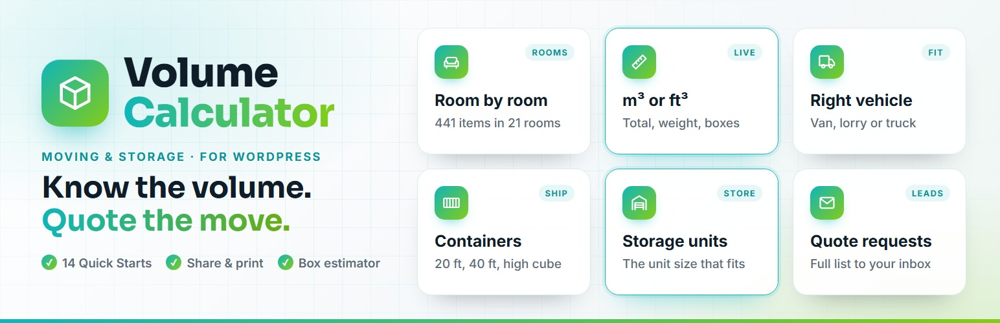
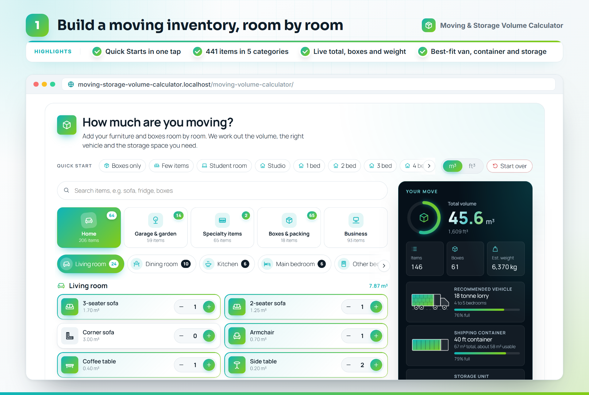
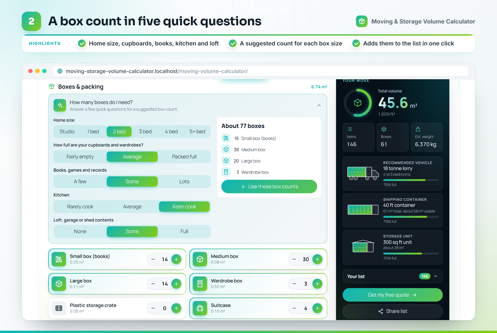
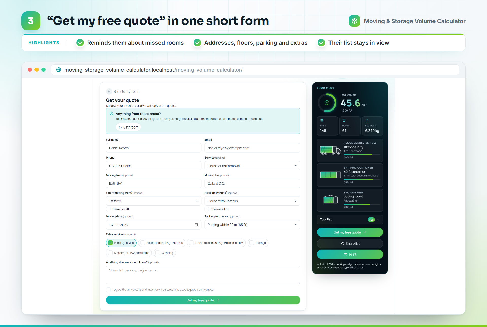
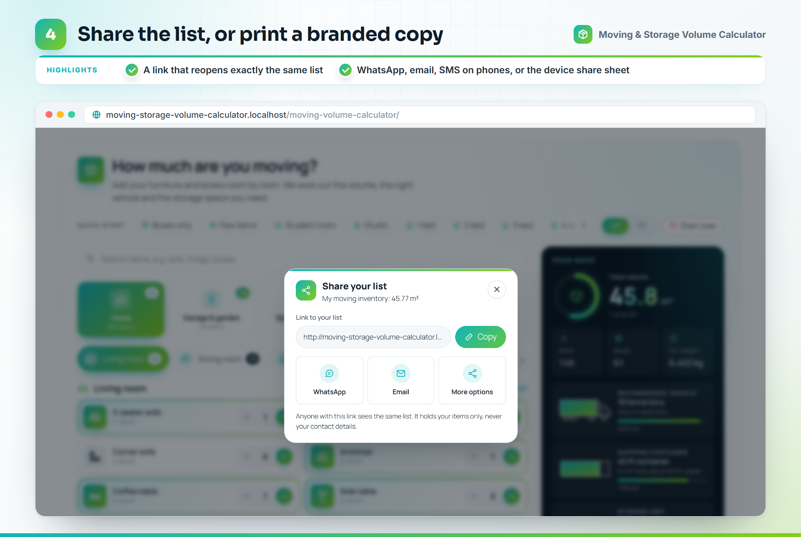
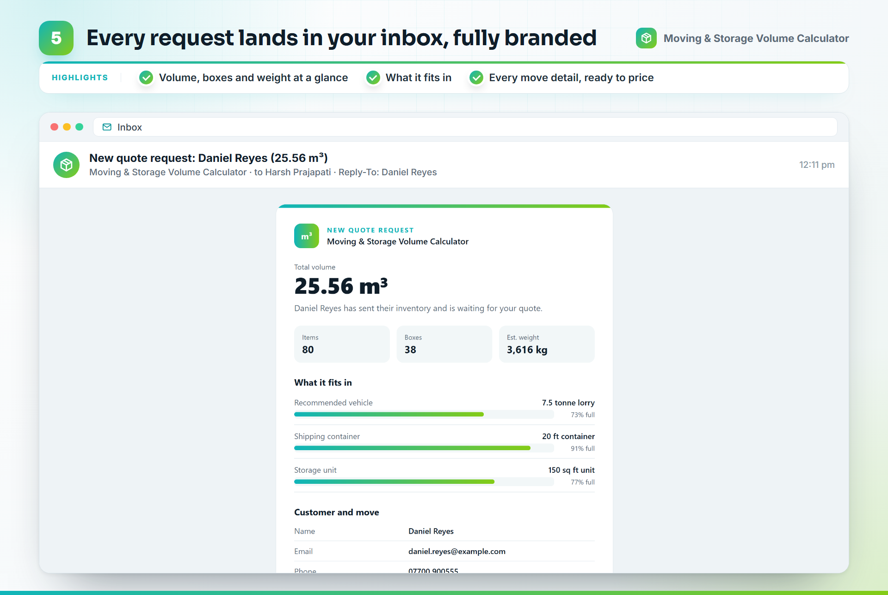
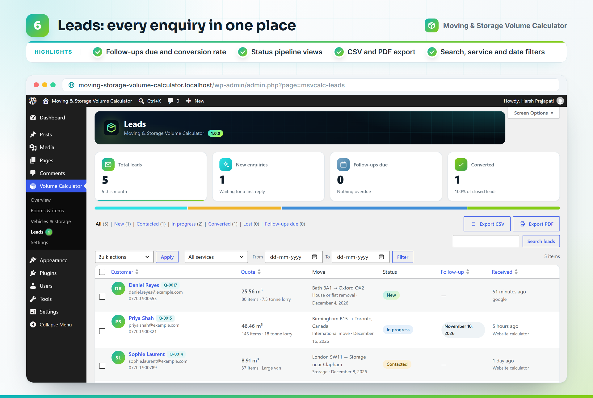
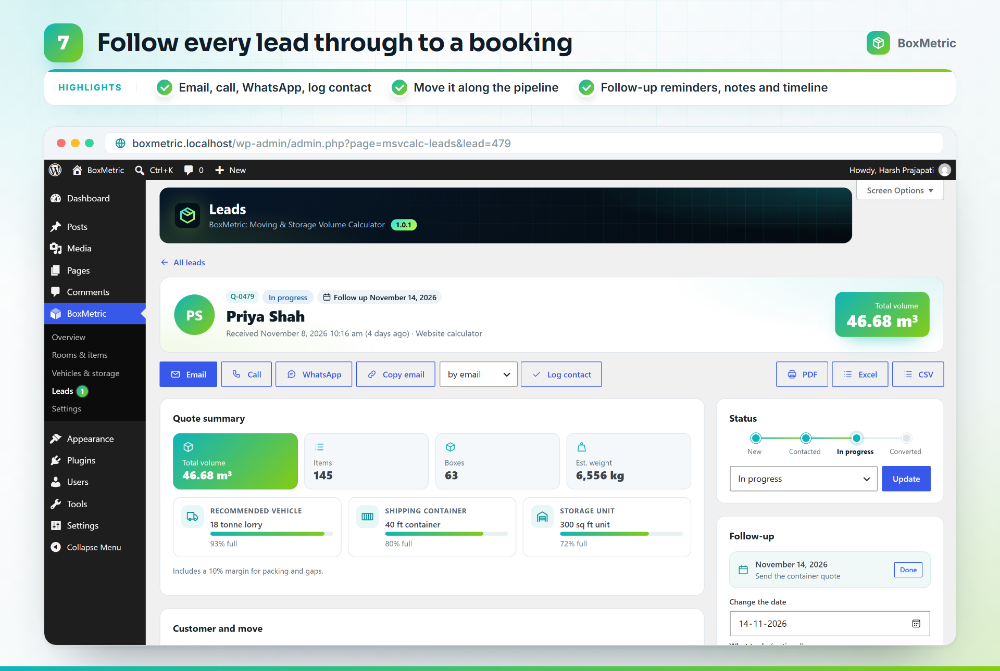
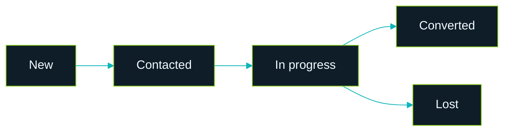

<p align="center">
  
</p>

<h1 align="center">Moving &amp; Storage Volume Calculator</h1>

<p align="center">
  
</p>

<p align="center">
  <b>Know the volume. Quote the move.</b><br>
  A free moving volume calculator for WordPress, in cubic feet or cubic metres.<br>
  Customers list their items room by room, see what size moving truck, container and storage unit they need,<br>
  and send it to you as a ready-to-price quote request. No external services, no tracking.
</p>

<p align="center">
  <a href="https://github.com/xaviermsd/moving-storage-volume-calculator/releases/latest"></a>
  <a href="#see-it-in-action"></a>
</p>

<p align="center">
  
  
  
  
  
  
</p>

<p align="center">
  <a href="#build-the-inventory"><b>Inventory</b></a> ·
  <a href="#count-the-boxes"><b>Boxes</b></a> ·
  <a href="#get-the-quote-request"><b>Quote</b></a> ·
  <a href="#share-or-print-the-list"><b>Share</b></a> ·
  <a href="#every-request-in-your-inbox"><b>Email</b></a> ·
  <a href="#manage-every-lead"><b>Leads</b></a> ·
  <a href="#install-in-a-minute">Install</a> ·
  <a href="#faq">FAQ</a> ·
  <a href="#for-developers">Developers</a>
</p>

---

## Why movers use it

Built for **moving companies, removal firms, man and van services, self-storage operators, international movers and office movers** in the UK, Europe, the United States and Australia.

- **Better leads, fewer phone calls.** Every enquiry arrives with the full item list, the volume, the weight and the move details, so you can price it straight away.
- **Fewer surprises on moving day.** Customers are reminded about the rooms they skipped, the most common reason estimates come out too small.
- **Your brand, not ours.** Your colours, your units, your vehicles. No credit link unless you turn it on.
- **Your data stays yours.** Leads live in your own WordPress. Nothing is sent to anyone else.

## What do you want to do?

Click a task to jump straight to how it works.

- **Let customers work out how much they are moving**<br>A **room-by-room inventory** with 441 items and a live total · [Show me](#build-the-inventory)
- **Fill a typical home in one tap**<br>**14 Quick Starts**, from "Boxes only" to "5 bed", office, shop and café · [Show me](#build-the-inventory)
- **Help customers who have no idea how many boxes they need**<br>A **box estimator**: five questions, one count per box size · [Show me](#count-the-boxes)
- **Get the address, floors, parking and date with the list**<br>A **short quote form** under the inventory · [Show me](#get-the-quote-request)
- **Receive enquiries you can price at a glance**<br>A **branded email** with the volume, weight and best-fit vehicle · [Show me](#every-request-in-your-inbox)
- **Follow up every enquiry until it is booked**<br>**Leads**: statuses, follow-up reminders, notes, Excel, CSV and PDF · [Show me](#manage-every-lead)

> [!TIP]
> Add the **Volume Calculator** block to any page, or the shortcode `[msvcalc_calculator]`. It works out of
> the box with UK, European, US or Australian vehicle and storage sizes.

---

## See it in action

<a href="https://youtu.be/raBU40QdFeY"></a>

[Watch the full guide on YouTube (4:33)](https://youtu.be/raBU40QdFeY). Every screen uses demo data.


## Build the inventory



- **441 items in 21 rooms**, grouped into Home, Garage & garden, Specialty items, Boxes & packing and Business.
- **Quick Starts** fill a typical home in one tap. Customers then adjust the quantities.
- **Search** every room at once ("sofa", "fridge", "boxes").
- **Live total** in m³ or ft³, with the number of items, boxes and an estimated weight.
- **What it fits in**: the right van or truck, shipping container and storage unit, drawn filling up as items are added.
- **Something not listed?** Customers add their own item with its size and an icon.

<details>
<summary><b>Everything customers can do on the calculator</b></summary>
<br>

- Switch between m³ and ft³ at any time.
- Clear the list with **Start over**, and undo it.
- Come back later: the list is remembered in their browser.
- A packing margin (10% by default) is added for gaps when loading.
- Light, dark or automatic theme in your brand colour.

</details>

---

## Count the boxes



Most customers have no idea how many boxes they need. Under **Boxes & packing**, the box estimator asks five
quick questions (home size, cupboards, books, kitchen and loft) and suggests a count for each box size.
One click adds them all to the list, and it can be undone.

---

## Get the quote request



1. The customer clicks **Get my free quote**.
2. A reminder lists the rooms they have not added anything from, such as the bathroom or the loft.
3. They fill in name, email and phone, then the optional move details: addresses, floors and lifts, date, parking and extra services.
4. They click **Get my free quote** and see a confirmation with a recap. From there they can print a copy, change the list and send again, or start a new list.

<details>
<summary><b>Choose which fields to show</b></summary>
<br>

Under **Volume Calculator > Settings > Quote form** you choose which fields appear and which are required,
the thank-you message or page, the email that receives requests, and whether the customer gets a copy.

</details>

---

## Share or print the list



- **Share** creates a link that opens the same list on any device. It holds the items only, never contact details, and nothing is stored on your server.
- **Print** gives a clean, branded inventory with the totals and what it fits in.

---

## Every request in your inbox



Each request arrives as a branded email with the total volume, items, boxes and weight, the best-fit vehicle,
container and storage unit, every customer and move detail, and the full item list room by room.
**Reply** goes straight to the customer.

> [!NOTE]
> If your site's email fails, the request is still saved as a lead and flagged. The Dashboard shows a notice,
> and the lead has a **Send email again** button.

---

## Manage every lead



**Volume Calculator > Leads** keeps every enquiry in one place.

- Totals for new enquiries, follow-ups due and your conversion rate.
- Status views: New, Contacted, In progress, Converted and Lost.
- Search, filter by service and date, sort and bulk-update.
- Export the filtered list as a branded **Excel** workbook (with an item-by-item inventory sheet), a plain **CSV** for your CRM, or a **PDF report**.



Open a lead to **email, call or WhatsApp** the customer in one click, log the contact, move it along the
pipeline, set a **follow-up reminder** and keep **notes**. A timeline records everything that happened.



<details>
<summary><b>Let your staff manage leads</b></summary>
<br>

Under **Settings > Data & privacy > Who can manage leads**, choose **Administrators only** or
**Administrators and Editors**. Editors then see the Leads screen only, not the plugin's settings.

</details>

<details>
<summary><b>Privacy built in</b></summary>
<br>

- An optional consent checkbox, with the wording the customer agreed to saved on the lead.
- WordPress's **Export Personal Data** and **Erase Personal Data** tools include leads.
- Delete old requests automatically after the number of days you choose.
- Suggested text for your privacy policy.
- Repeat requests within 15 minutes are merged, and a rate limit stops spam floods.

</details>

---

## Install in a minute

**From GitHub**

1. Download `moving-storage-volume-calculator.zip` from the [latest release](https://github.com/xaviermsd/moving-storage-volume-calculator/releases/latest).
2. In WordPress, go to **Plugins > Add New > Upload Plugin** and choose the zip.
3. Click **Install Now**, then **Activate**.

Then add the **Volume Calculator** block to a page, or paste the shortcode:

```text
[msvcalc_calculator]
```

**Requirements:** WordPress 6.7+ and PHP 7.4+.

## Make it yours

**Volume Calculator** in the admin menu:

- **Overview**<br>Quick links, the shortcode and what is waiting for a reply.
- **Rooms & items**<br>Edit any room, item, volume or Quick Start, choose from more than 220 icons, and import or export the list as JSON.
- **Vehicles & storage**<br>Your own vans, trucks, containers and storage units.
- **Leads**<br>Every enquiry, as above.
- **Settings**<br>Calculator, Look & feel, Quote form, Data & privacy.

<details>
<summary><b>Shortcode options</b></summary>
<br>

| Option | Values | Example |
| --- | --- | --- |
| `units` | `m3`, `ft3` | `[msvcalc_calculator units="ft3"]` |
| `theme` | `light`, `dark`, `auto` | `[msvcalc_calculator theme="dark"]` |
| `quote` | `yes`, `no` | `[msvcalc_calculator quote="no"]` |
| `intro` | Any text | `[msvcalc_calculator intro="Plan your move in minutes."]` |
| `accent` | A hex colour | `[msvcalc_calculator accent="#0fb5ba"]` |

The block has the same options in its sidebar.

</details>

## FAQ

The questions movers and their customers ask most, answered with the plugin's own default figures.

<details>
<summary><b>How do I add a moving volume calculator to my WordPress website?</b></summary>

Install the plugin, then add the "Volume Calculator" block to any page, or paste the shortcode `[msvcalc_calculator]` anywhere shortcodes work, including page builders. Choose your region, unit (cubic feet or cubic metres) and the email that should receive quote requests under Volume Calculator → Settings.

</details>

<details>
<summary><b>Is this a moving cost calculator?</b></summary>

No prices are shown to the customer. Moving costs depend on your rates, distance, access and services, so the calculator gives you what you need to price the job: the volume, weight, item list, addresses, floors, parking, date and extra services. You send the quote yourself.

</details>

<details>
<summary><b>How can a moving company get more leads from its website?</b></summary>

Give visitors a useful tool instead of a plain contact form. People planning a move want to know how much they have and what size truck or storage unit they need. This calculator answers that, then asks for their details to "Get my free quote". Every lead arrives complete and is kept under Volume Calculator → Leads, with statuses, follow-up reminders, notes and Excel, CSV or PDF export.

</details>

<details>
<summary><b>How many cubic feet is a 1, 2, 3 or 4 bedroom house?</b></summary>

These are the plugin's Quick Start totals for a typically furnished home, including a 10% packing margin:

* Studio: about 11 m³ (400 cu ft)
* 1 bedroom: about 17 m³ (600 cu ft)
* 2 bedrooms: about 24 m³ (850 cu ft)
* 3 bedrooms: about 36 m³ (1,250 cu ft)
* 4 bedrooms: about 47 m³ (1,650 cu ft)
* 5 bedrooms: about 60 m³ (2,100 cu ft)

Every home is different, so customers adjust the list item by item.

</details>

<details>
<summary><b>What size moving truck or removal van do I need?</b></summary>

It depends on the volume. With the default sizes: a 15 ft truck (about 21 m³) or a Luton van (about 18 m³) suits a 1 bedroom home. A 20 ft truck (about 28 m³) suits 2 bedrooms. A 7.5 tonne lorry (about 35 m³) suits a smaller 3 bedroom home, and a 26 ft truck (about 45 m³) suits a 3 bedroom or lightly furnished 4 bedroom home. A 4 bedroom home needs an 18 tonne lorry (about 50 m³), and larger homes a removal pantechnicon (about 85 m³) or two trips. The calculator picks the best fit and shows how full it will be.

</details>

<details>
<summary><b>What size storage unit do I need?</b></summary>

As a guide with the default sizes: a 1 bedroom home fits a 10×10 ft or 100 sq ft unit, 2 bedrooms a 10×15 ft or 150 sq ft unit, 3 bedrooms a 10×20 ft or 200 sq ft unit, and 4 bedrooms a 10×30 ft or 300 sq ft unit. The calculator suggests the smallest unit that fits the list. Storage companies can enter their own unit sizes.

</details>

<details>
<summary><b>Will my furniture fit in a 20 ft or 40 ft shipping container?</b></summary>

A 20 ft container holds about 28 m³ (1,000 cu ft), enough for a studio to a 2 bedroom home. A 40 ft container holds about 58 m³ (2,050 cu ft), enough for a 3 or 4 bedroom home, and a 40 ft high cube about 66 m³. The calculator shows which container fits the list.

</details>

<details>
<summary><b>How many moving boxes do I need?</b></summary>

The Quick Starts include about 18 boxes for a studio, 25 for 1 bedroom, 38 for 2 bedrooms, 49 for 3 bedrooms, 63 for 4 bedrooms and 75 for 5 bedrooms. The box estimator asks five quick questions (home size, cupboards and wardrobes, books, kitchen, and loft or garage) and suggests a count for each box size.

</details>

<details>
<summary><b>How do you calculate moving volume?</b></summary>

Add up the volume of every item (length × width × height), then add a margin for the gaps when loading. The calculator does this for 441 common items with typical volumes that include wrapping, and adds a 10% packing margin by default. 1 cubic metre is 35.3 cubic feet.

</details>

<details>
<summary><b>How accurate is the total?</b></summary>

It is an estimate. Each item has a typical volume, and the packing margin covers gaps when loading. You can change every volume and the margin to match how your team packs.

</details>

<details>
<summary><b>Does it work for storage, office and international moves?</b></summary>

Yes. Quick Starts cover a storage unit, a garage and shed, a small office, a shop and a café, and the results include storage units and shipping containers as well as vans and trucks. Turn off what you do not offer in the settings.

</details>

<details>
<summary><b>Can I use my own vans, trucks and storage units?</b></summary>

Yes. Edit the sizes or add your own under Volume Calculator → Vehicles & storage. Every room, item, volume, icon and Quick Start can be changed under Rooms & items.

</details>

<details>
<summary><b>Can I change the settings for one page only?</b></summary>

Yes. The shortcode accepts `units` (m3 or ft3), `theme` (light, dark or auto), `quote` (yes or no), `title`, `intro` and `accent` (a hex colour). For example: `[msvcalc_calculator units="ft3" theme="dark" quote="no"]`. The block has the same options in its sidebar.

</details>

<details>
<summary><b>Emails are not arriving. What can I do?</b></summary>

The plugin uses WordPress's own email function. If your site's other emails also go missing, install an SMTP plugin to send through a proper mail service. While "Store requests" is on, every request is also saved under Volume Calculator → Leads, and a failed email is flagged there with a "Send email again" button.

</details>

<details>
<summary><b>What happens to my data when I delete the plugin?</b></summary>

By default your settings, items and quote requests are kept, in case you reinstall. Turn on "Remove data" in Volume Calculator → Settings → Data & privacy to delete them with the plugin.

</details>

---

## For developers

<details>
<summary><b>Commands</b></summary>
<br>

```bash
phpcs                                   # WordPress Coding Standards + PHP 7.4+ compatibility
php bin/build-icons.php                 # rebuild assets/js/icons.js after editing icons
bash bin/build-zip.sh                   # release zip in build/, without development files
wp i18n make-pot . languages/moving-storage-volume-calculator.pot --exclude=build,bin
```

There is no build step for the scripts. The block uses the editor's global packages.

</details>

<details>
<summary><b>Hooks and REST</b></summary>
<br>

- **`msvcalc_quote_received`** (action)<br>Fires after a request is saved and emailed: `( int $lead_id, array $contact, array $result )`.
- **`msvcalc_rate_limit`** (filter)<br>Requests allowed per visitor in the rate-limit window. Default `5`.
- **`POST /wp-json/msvcalc/v1/quote`**<br>The endpoint the quote form sends to.

</details>

<details>
<summary><b>Quality gates</b></summary>
<br>

- **WordPress Coding Standards**<br>`WordPress` ruleset, zero errors and warnings
- **PHP compatibility**<br>PHP 7.4 and newer
- **Plugin Check**<br>The official WordPress.org check, on the release build: no errors
- **Security**<br>Nonces and capability checks on every action, escaped output, prepared queries

</details>

<details>
<summary><b>Project layout</b></summary>
<br>

```
moving-storage-volume-calculator.php   Plugin header and loader
uninstall.php                          Removes data only when the user asked for it
includes/                              One class per job (calculator, leads, mailer, REST, privacy, ...)
templates/                             Admin screens, the email and the PDF report
assets/                                Scripts, styles and icons for the calculator and the admin
blocks/                                The Volume Calculator block
data/                                  Shipped rooms, items, presets and regional tables
languages/                             Translation template
.wordpress-org/                        Banner, icon and screenshots for the listing
```

</details>

<details>
<summary><b>Brand colours</b></summary>
<br>

| | Colour | Used for |
| --- | --- | --- |
|  | `#0fb5ba` Teal | Main accent, start of the gradient |
|  | `#84cc16` Lime | End of the gradient |
|  | `#0f1d29` Ink | Text and dark panels |
|  | `#f2fbff` Ice | Text on dark |
|  | `#a9bdcc` Mist | Secondary text |

</details>

## Contributing

Issues and pull requests are welcome on [GitHub](https://github.com/xaviermsd/moving-storage-volume-calculator/issues).
For a security issue, please contact me privately instead of opening a public issue.

## License

GPL-2.0-or-later. See [LICENSE](LICENSE).

---

<h3 align="center">Need a calculator, CRM or plugin built for your business?</h3>

<p align="center">
  I build WordPress plugins, CRMs and web apps that save teams hours every week.<br>
  Tell me what slows your team down, and let's fix it.
</p>

<p align="center">
  <a href="https://wa.me/919898528376?text=Hi%20Harsh%2C%20I%20saw%20the%20Moving%20%26%20Storage%20Volume%20Calculator%20on%20GitHub%20and%20have%20a%20project%20in%20mind."></a>&nbsp;
  <a href="https://www.linkedin.com/in/iamharshprajapati/"></a>&nbsp;
  <a href="https://www.instagram.com/harshprajapatiofficial/"></a>
</p>

<p align="center">
  <br>
  <sub>Made by <a href="https://github.com/xaviermsd">Harsh Prajapati</a>. Also by the same author:
  <a href="https://wordpress.org/plugins/fieldpilot-for-acf/">FieldPilot, AI and JSON copilot for ACF</a> and
  <a href="https://wordpress.org/plugins/menunest-smart-menu-manager/">MenuNest, the smart menu manager for WordPress</a>.</sub>
</p>
