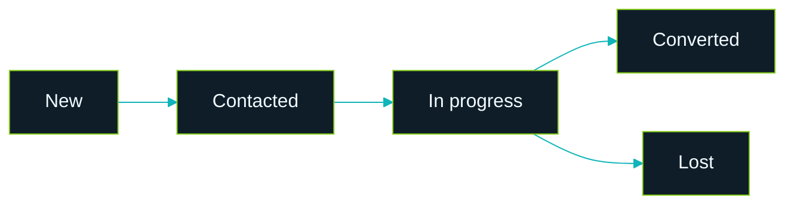
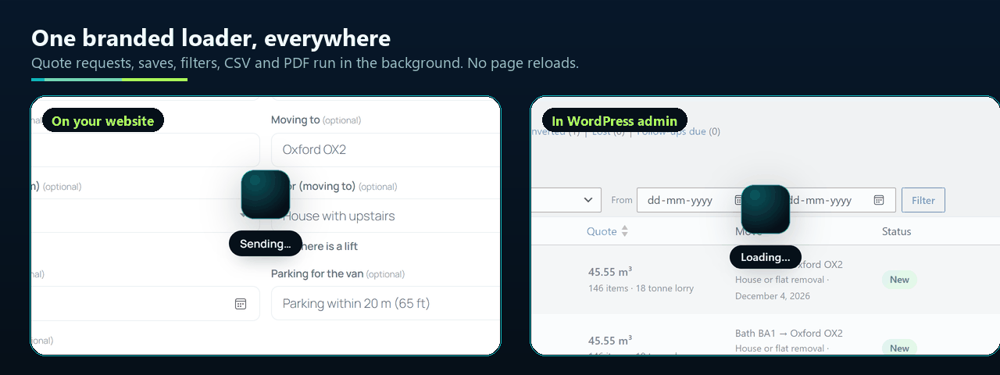

<h1 align="center">
   Moving &amp; Storage Volume Calculator
</h1>

<p align="center">
  
</p>

<p align="center">
  <b>Know the volume. Quote the move.</b><br>
  A room-by-room moving volume calculator for removal, moving and storage companies.<br>
  Customers build their inventory, see the total, the right van, container and storage unit,<br>
  and send it to you as a ready-to-price lead. No external services, no tracking.
</p>

<p align="center">
  <a href="https://github.com/xaviermsd/moving-storage-volume-calculator/releases/latest"></a>
  <a href="#see-it-in-action"></a>
</p>

<p align="center">
  
  
  
  
  
  
</p>

<p align="center">
  <a href="#build-the-inventory"><b>Inventory</b></a> ·
  <a href="#count-the-boxes"><b>Boxes</b></a> ·
  <a href="#get-the-quote-request"><b>Quote</b></a> ·
  <a href="#share-or-print-the-list"><b>Share</b></a> ·
  <a href="#every-request-in-your-inbox"><b>Email</b></a> ·
  <a href="#manage-every-lead"><b>Leads</b></a> ·
  <a href="#install-in-a-minute">Install</a> ·
  <a href="#faq">FAQ</a> ·
  <a href="#for-developers">Developers</a>
</p>

---

## Why movers use it

- **Better leads, fewer phone calls.** Every enquiry arrives with the full item list, the volume, the weight and the move details, so you can price it straight away.
- **Fewer surprises on moving day.** Customers are reminded about the rooms they skipped, the most common reason estimates come out too small.
- **Your brand, not ours.** Your colours, your units, your vehicles. No credit link unless you turn it on.
- **Your data stays yours.** Leads live in your own WordPress. Nothing is sent to anyone else.

## What do you want to do?

Click a task to jump straight to how it works.

- **Let customers work out how much they are moving**<br>A **room-by-room inventory** with 441 items and a live total · [Show me](#build-the-inventory)
- **Fill a typical home in one tap**<br>**14 Quick Starts**, from "Boxes only" to "5 bed", office, shop and café · [Show me](#build-the-inventory)
- **Help customers who have no idea how many boxes they need**<br>A **box estimator**: five questions, one count per box size · [Show me](#count-the-boxes)
- **Get the address, floors, parking and date with the list**<br>A **short quote form** under the inventory · [Show me](#get-the-quote-request)
- **Receive enquiries you can price at a glance**<br>A **branded email** with the volume, weight and best-fit vehicle · [Show me](#every-request-in-your-inbox)
- **Follow up every enquiry until it is booked**<br>**Leads**: statuses, follow-up reminders, notes, CSV and PDF · [Show me](#manage-every-lead)

> [!TIP]
> Add the **Volume Calculator** block to any page, or the shortcode `[msvcalc_calculator]`. It works out of
> the box with UK, European, US or Australian vehicle and storage sizes.

---

## See it in action


## Build the inventory


- **441 items in 21 rooms**, grouped into Home, Garage & garden, Specialty items, Boxes & packing and Business.
- **Quick Starts** fill a typical home in one tap. Customers then adjust the quantities.
- **Search** every room at once ("sofa", "fridge", "boxes").
- **Live total** in m³ or ft³, with the number of items, boxes and an estimated weight.
- **What it fits in**: the right van or truck, shipping container and storage unit, drawn filling up as items are added.
- **Something not listed?** Customers add their own item with its size and an icon.

<details>
<summary><b>Everything customers can do on the calculator</b></summary>
<br>

- Switch between m³ and ft³ at any time.
- Clear the list with **Start over**, and undo it.
- Come back later: the list is remembered in their browser.
- A packing margin (10% by default) is added for gaps when loading.
- Light, dark or automatic theme in your brand colour.

</details>

---

## Count the boxes


Most customers have no idea how many boxes they need. Under **Boxes & packing**, the box estimator asks five
quick questions (home size, cupboards, books, kitchen and loft) and suggests a count for each box size.
One click adds them all to the list, and it can be undone.

---

## Get the quote request


1. The customer clicks **Get my free quote**.
2. A reminder lists the rooms they have not added anything from, such as the bathroom or the loft.
3. They fill in name, email and phone, then the optional move details: addresses, floors and lifts, date, parking and extra services.
4. They click **Get my free quote** and see a confirmation with a recap. From there they can print a copy, change the list and send again, or start a new list.

<details>
<summary><b>Choose which fields to show</b></summary>
<br>

Under **Volume Calculator > Settings > Quote form** you choose which fields appear and which are required,
the thank-you message or page, the email that receives requests, and whether the customer gets a copy.

</details>

---

## Share or print the list


- **Share** creates a link that opens the same list on any device. It holds the items only, never contact details, and nothing is stored on your server.
- **Print** gives a clean, branded inventory with the totals and what it fits in.

---

## Every request in your inbox


Each request arrives as a branded email with the total volume, items, boxes and weight, the best-fit vehicle,
container and storage unit, every customer and move detail, and the full item list room by room.
**Reply** goes straight to the customer.

> [!NOTE]
> If your site's email fails, the request is still saved as a lead and flagged. The Dashboard shows a notice,
> and the lead has a **Send email again** button.

---

## Manage every lead


**Volume Calculator > Leads** keeps every enquiry in one place.

- Totals for new enquiries, follow-ups due and your conversion rate.
- Status views: New, Contacted, In progress, Converted and Lost.
- Search, filter by service and date, sort and bulk-update.
- Export the filtered list as **CSV** or a **PDF report**.


Open a lead to **email, call or WhatsApp** the customer in one click, log the contact, move it along the
pipeline, set a **follow-up reminder** and keep **notes**. A timeline records everything that happened.



<details>
<summary><b>Let your staff manage leads</b></summary>
<br>

Under **Settings > Data & privacy > Who can manage leads**, choose **Administrators only** or
**Administrators and Editors**. Editors then see the Leads screen only, not the plugin's settings.

</details>

<details>
<summary><b>Privacy built in</b></summary>
<br>

- An optional consent checkbox, with the wording the customer agreed to saved on the lead.
- WordPress's **Export Personal Data** and **Erase Personal Data** tools include leads.
- Delete old requests automatically after the number of days you choose.
- Suggested text for your privacy policy.
- Repeat requests within 15 minutes are merged, and a rate limit stops spam floods.

</details>

---

## Install in a minute

**From GitHub**

1. Download `moving-storage-volume-calculator.zip` from the [latest release](https://github.com/xaviermsd/moving-storage-volume-calculator/releases/latest).
2. In WordPress, go to **Plugins > Add New > Upload Plugin** and choose the zip.
3. Click **Install Now**, then **Activate**.

Then add the **Volume Calculator** block to a page, or paste the shortcode:

```text
[msvcalc_calculator]
```

**Requirements:** WordPress 6.7+ and PHP 7.4+.

## Make it yours

**Volume Calculator** in the admin menu:

- **Overview**<br>Quick links, the shortcode and what is waiting for a reply.
- **Rooms & items**<br>Edit any room, item, volume or Quick Start, choose from more than 220 icons, and import or export the list as JSON.
- **Vehicles & storage**<br>Your own vans, trucks, containers and storage units.
- **Leads**<br>Every enquiry, as above.
- **Settings**<br>Calculator, Look & feel, Quote form, Data & privacy.

Every save, filter, CSV download and PDF report runs in the background behind one branded loader, so the screen never reloads.



<details>
<summary><b>Shortcode options</b></summary>
<br>

| Option | Values | Example |
| --- | --- | --- |
| `units` | `m3`, `ft3` | `[msvcalc_calculator units="ft3"]` |
| `theme` | `light`, `dark`, `auto` | `[msvcalc_calculator theme="dark"]` |
| `quote` | `yes`, `no` | `[msvcalc_calculator quote="no"]` |
| `intro` | Any text | `[msvcalc_calculator intro="Plan your move in minutes."]` |
| `accent` | A hex colour | `[msvcalc_calculator accent="#0fb5ba"]` |

The block has the same options in its sidebar.

</details>

## FAQ

<details>
<summary><b>Which regions are supported?</b></summary>
<br>
Vehicle and storage sizes are included for the UK, Europe, the United States and Australia. You can edit
them or add your own under Vehicles & storage.
</details>

<details>
<summary><b>Do I need an account or API key?</b></summary>
<br>
No. Everything runs on your own site.
</details>

<details>
<summary><b>Where are the leads stored?</b></summary>
<br>
In your own WordPress database, as private entries that are never shown on your site.
</details>

<details>
<summary><b>What if my site's emails don't arrive?</b></summary>
<br>
The plugin uses WordPress's own email function. If other emails from your site also go missing, install an
SMTP plugin. Requests are still saved under Leads, and a failed email can be sent again from the lead.
</details>

<details>
<summary><b>Can I change the items and volumes?</b></summary>
<br>
Yes. Every room, item, volume, icon and Quick Start can be changed under Rooms & items.
</details>

<details>
<summary><b>What happens to my data when I delete the plugin?</b></summary>
<br>
By default your leads and settings are kept in case you reinstall. Turn on <b>Remove data</b> under
Settings > Data & privacy to delete them with the plugin.
</details>

<details>
<summary><b>Does it track visitors or call outside services?</b></summary>
<br>
No. The calculator makes no external requests and collects nothing until the customer sends a request.
</details>

---

## For developers

<details>
<summary><b>Commands</b></summary>
<br>

```bash
phpcs                                   # WordPress Coding Standards + PHP 7.4+ compatibility
php bin/build-icons.php                 # rebuild assets/js/icons.js after editing icons
bash bin/build-zip.sh                   # release zip in build/, without development files
wp i18n make-pot . languages/moving-storage-volume-calculator.pot --exclude=build,bin
```

There is no build step for the scripts. The block uses the editor's global packages.

</details>

<details>
<summary><b>Hooks and REST</b></summary>
<br>

- **`msvcalc_quote_received`** (action)<br>Fires after a request is saved and emailed: `( int $lead_id, array $contact, array $result )`.
- **`msvcalc_rate_limit`** (filter)<br>Requests allowed per visitor in the rate-limit window. Default `5`.
- **`POST /wp-json/msvcalc/v1/quote`**<br>The endpoint the quote form sends to.

</details>

<details>
<summary><b>Quality gates</b></summary>
<br>

- **WordPress Coding Standards**<br>`WordPress` ruleset, zero errors and warnings
- **PHP compatibility**<br>PHP 7.4 and newer
- **Plugin Check**<br>The official WordPress.org check, on the release build: no errors
- **Security**<br>Nonces and capability checks on every action, escaped output, prepared queries

</details>

<details>
<summary><b>Project layout</b></summary>
<br>

```
moving-storage-volume-calculator.php   Plugin header and loader
uninstall.php                          Removes data only when the user asked for it
includes/                              One class per job (calculator, leads, mailer, REST, privacy, ...)
templates/                             Admin screens, the email and the PDF report
assets/                                Scripts, styles and icons for the calculator and the admin
blocks/                                The Volume Calculator block
data/                                  Shipped rooms, items, presets and regional tables
languages/                             Translation template
.wordpress-org/                        Banner, icon and screenshots for the listing
```

</details>

<details>
<summary><b>Brand colours</b></summary>
<br>

| | Colour | Used for |
| --- | --- | --- |
|  | `#0fb5ba` Teal | Main accent, start of the gradient |
|  | `#84cc16` Lime | End of the gradient |
|  | `#0f1d29` Ink | Text and dark panels |
|  | `#f2fbff` Ice | Text on dark |
|  | `#a9bdcc` Mist | Secondary text |

</details>

## Contributing

Issues and pull requests are welcome on [GitHub](https://github.com/xaviermsd/moving-storage-volume-calculator/issues).
For a security issue, please contact me privately instead of opening a public issue.

## License

GPL-2.0-or-later. See [LICENSE](LICENSE).

---

<h3 align="center">Need a calculator, CRM or plugin built for your business?</h3>

<p align="center">
  I build WordPress plugins, CRMs and web apps that save teams hours every week.<br>
  Tell me what slows your team down, and let's fix it.
</p>

<p align="center">
  <a href="https://wa.me/919898528376?text=Hi%20Harsh%2C%20I%20saw%20the%20Moving%20%26%20Storage%20Volume%20Calculator%20on%20GitHub%20and%20have%20a%20project%20in%20mind."></a>&nbsp;
  <a href="https://www.linkedin.com/in/iamharshprajapati/"></a>&nbsp;
  <a href="https://www.instagram.com/harshprajapatiofficial/"></a>
</p>

<p align="center">
  <br>
  <sub>Made by <a href="https://github.com/xaviermsd">Harsh Prajapati</a>. Also by the same author:
  <a href="https://wordpress.org/plugins/fieldpilot-for-acf/">FieldPilot, AI and JSON copilot for ACF</a> and
  <a href="https://wordpress.org/plugins/menunest-smart-menu-manager/">MenuNest, the smart menu manager for WordPress</a>.</sub>
</p>
